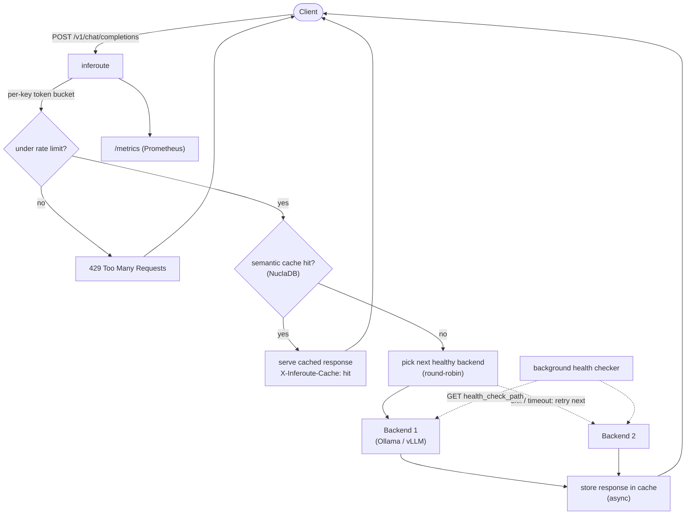

# inferoute

[](https://github.com/Rakshit-gen/inferoute/actions/workflows/ci.yml)
[](LICENSE)

An OpenAI-compatible inference gateway written in Go: it load-balances
requests across multiple LLM backends serving the same model (e.g. several
Ollama or vLLM instances), keeping each conversation on the backend whose
KV cache already holds it, health-checks them, fails over to the next
healthy one on error, streams SSE responses straight through unbuffered,
rate-limits per API key (in-process or shared across instances via Redis),
and semantically caches responses — streaming included — using
[NuclaDB](https://github.com/Rakshit-gen/NuclaDB).

## Why

The inference *engines* (vLLM, SGLang, llama.cpp, Ollama) are a solved,
crowded problem. The layer that routes to them — load balancing, failover,
caching, observability — is not, and it's infrastructure glue, which is
what Go is for.

## Architecture



Every arrow above is real request-handling code, not aspirational — see
`internal/proxy/proxy.go` for the exact order of operations.

## Quickstart

Run two Ollama instances serving the same model, so there's actually
something to route between:

```sh
OLLAMA_HOST=127.0.0.1:11434 ollama serve &
OLLAMA_HOST=127.0.0.1:11435 ollama serve &
ollama pull llama3
```

Install and run inferoute against them. The script downloads the latest
release binary for macOS or Linux into `~/.local/bin` and checks it against
the release's `checksums.txt` (with no release published it builds with
`go install` instead):

```sh
curl -fsSL https://raw.githubusercontent.com/Rakshit-gen/inferoute/main/install.sh | sh
curl -O https://raw.githubusercontent.com/Rakshit-gen/inferoute/main/config.example.json
inferouted -config config.example.json
```

Or build from source:

```sh
go build -o bin/inferouted ./cmd/inferouted
./bin/inferouted -config config.example.json
```

`config.example.json` already points at `:11434` and `:11435` for `llama3`.
Send it a request:

```sh
curl localhost:8081/v1/chat/completions \
  -d '{"model":"llama3","messages":[{"role":"user","content":"hi"}]}'
```

You'll get back whatever Ollama returns, unmodified — inferoute just picked
which of the two instances handled it:

```json
{"model":"llama3","message":{"role":"assistant","content":"..."}, ...}
```

Run it a few more times and kill one `ollama serve` process: the next
request fails over to the survivor instead of erroring. `/metrics` serves
Prometheus metrics, `/healthz` is a liveness probe, `/readyz` answers 503
while no backend can take traffic, `/v1/models` lists the
served models (OpenAI shape, for SDKs), `/v1/backends` reports each
backend's name, models, and current health, `/v1/config` reports the model
aliases and which features are enabled, `/v1/usage` reports the caller's
token budget when one is set, and `/docs` serves a full
documentation page straight from the running binary:

```sh
curl localhost:8081/v1/backends
# [{"name":"ollama-1","url":"http://localhost:11434","models":["llama3"],"healthy":true}, ...]
```

### No GPUs handy?

`scripts/local-stack.sh` builds and runs the gateway in front of two mock
inference backends (`scripts/mock-openai-backend`, which echoes prompts back
and can stream), so you can exercise routing, failover, streaming, and the
dashboard with nothing but Go installed:

```sh
./scripts/local-stack.sh          # gateway on :8091, Ctrl-C stops it
```

Or skip the local Go/Ollama install and run everything in containers:

```sh
docker compose up --build
```

That starts inferoute plus two Ollama containers (`docker-compose.yml`,
config in `config.docker.json`); `docker exec` into either Ollama container
to `ollama pull llama3` before sending traffic. Semantic caching and
Redis-backed rate limiting aren't included in the compose file — they need
NuclaDB and/or Redis running alongside it, see below.

### Deploy to Render

inferoute is a stateless HTTP proxy, so it deploys as a plain Render web
service built from `Dockerfile` — it doesn't need a database or persistent
disk itself:

1. **New > Web Service** on the [Render dashboard](https://dashboard.render.com),
   connect this repo, and pick **Docker** as the runtime. Render detects
   `Dockerfile` at the repo root automatically.
2. Set the health check path to `/healthz`.
3. Add your real `config.json` as a **Secret File** named `config.json`
   (Environment tab). Render mounts it at `/etc/secrets/config.json`, which
   is exactly what `Dockerfile`'s `CMD` points `-config` at by default — no
   start-command override needed.
4. Your backends (the Ollama/vLLM instances in that config) need to be
   reachable from Render's network — a `localhost` URL only works if
   inferoute and the backend are both running on your machine. Point it at
   a publicly reachable inference server, or run backend and gateway in the
   same private network.

Free-tier services spin down after 15 minutes of inactivity and take
30-60s to wake on the next request; the Starter plan keeps it always-on.

## CLI

The binary is `inferouted`:

```sh
./bin/inferouted -config path/to/config.json   # defaults to ./config.json
./bin/inferouted -config path/to/config.json -check   # validates and exits
./bin/inferouted -version                      # prints the version and exits
./bin/inferouted -h                            # prints usage and exits
```

There's no subcommand or interactive mode — it's a daemon: point it at a
config file, it starts listening, `Ctrl-C` (or `SIGTERM`) shuts it down
cleanly. A `SIGHUP` reloads the `backends` and `model_aliases` sections from
the same config file without restarting (`rate_limit`/`cache` settings are
not reloaded — those need a restart):

```sh
kill -HUP $(pgrep inferouted)
```

Everything else is controlled through the config file below or by calling
the HTTP API it serves.

## Configuration

Everything lives in one JSON file (see `config.example.json` for a working
one). Plain-English rundown of each section:

| Field | What it does |
|---|---|
| `listen_addr` | The address inferoute itself listens on, e.g. `:8081`. |
| `health_check_path`, `health_check_interval` | Which path to `GET` on each backend to check it's alive, and how often. |
| `backends` | The list of servers to route to. Each entry is `{name, url, models, path_prefix, api_key, weight}` — `models` is the list of model names that backend can serve (two backends listing the same model get load-balanced between); `path_prefix` is prepended to the client's request path for backends that mount their API under a path (e.g. Groq's OpenAI-compatible endpoint lives under `/openai`, so `path_prefix: "/openai"` turns a client's `/v1/chat/completions` into `/openai/v1/chat/completions`); `api_key`, if set, is sent as that backend's `Authorization: Bearer` header, overriding whatever the client sent — for gatewaying a hosted provider behind a key callers shouldn't need to know; `weight` biases the `weighted` load-balancing strategy toward beefier backends (default 1, ignored by the other strategies). All optional. |
| `load_balancing` | How to pick a backend among the healthy ones for a model: `round_robin` (default, even rotation), `least_pending` (fewest in-flight requests: best when request durations vary a lot), `weighted` (random, biased by each backend's `weight`), or `prefix_affinity` (send a chat request to the backend that already served the longest part of its conversation, so the engine's prefix cache is reused). |
| `rate_limit.enabled` | Turn per-API-key rate limiting on or off. Off by default. |
| `rate_limit.requests_per_second`, `.burst` | Steady-state rate and how many requests can burst above it before a caller starts getting `429`s. |
| `rate_limit.redis_addr` | Leave empty for a per-instance limiter (fine for one gateway). Set to a `host:port` to share limit state across a fleet of inferoute instances via Redis instead. |
| `cache.enabled` | Turn semantic response caching on or off. Off by default, and requires a running [NuclaDB](https://github.com/Rakshit-gen/NuclaDB) instance. |
| `cache.nucladb_addr` | Where that NuclaDB instance is. |
| `cache.embedding_backend_addr`, `.embedding_model` | Which Ollama-compatible server and model to use to turn a prompt into a vector for cache lookups. |
| `cache.max_distance` | How close a cached prompt has to be to count as a hit — see the note below, the naming here is easy to get backwards. |
| `cache.tenant_id` | The NuclaDB tenant inferoute's cache vectors are stored under. |
| `model_aliases` | Maps a requested model name to the one your backends actually serve, e.g. `{"gpt-4": "llama3"}` routes `gpt-4` requests to whatever backend lists `llama3`. Empty by default (no aliasing). |
| `cors_origins` | Browser origins allowed to call the HTTP API directly. `["*"]` allows any origin; otherwise list each exactly. Empty by default, which allows none. The `web/` dashboard calls gateways from its server and does not need an entry. Non-browser clients send no `Origin` and are unaffected. |
| `api_keys` | Allowlist of bearer tokens. When non-empty, every `/v1/*` route and `/metrics` require a listed `Authorization: Bearer <key>` and answer `401` otherwise. `/healthz`, `/readyz` and `/docs` stay public. Empty (the default) leaves the gateway open. Values may use `${VAR}`. Reloaded on `SIGHUP`. |
| `trusted_proxies` | CIDR ranges of proxies whose `X-Forwarded-For` is believed when identifying a client. Empty by default, so the header is ignored. |
| `max_request_body_bytes` | Largest accepted request body. Defaults to 16 MiB. |
| `max_concurrent_requests` | Requests handled at once before the gateway answers `503` with `Retry-After`. Defaults to 1024; `0` disables the limit. |
| `upstream_timeout` | How long to wait for a backend's response headers, which for a non-streaming request is the whole generation. Defaults to `5m`. |
| `stream_idle_timeout` | Longest allowed gap between response chunks. Defaults to `2m`. |
| `shutdown_timeout` | How long running requests get to finish after `SIGTERM`. Defaults to `30s`. |
| `cache.ttl`, `cache.lookup_timeout` | How long an entry may be served (default `24h`, `0s` keeps it indefinitely) and the limit on the lookup made before each request (default `2s`). |
| `usage.budget_tokens`, `.budget_window` | Tokens (prompt + completion, as the backend reports them) each caller may use per window, e.g. `1000000` per `24h` (the default window). `0`, the default, means no budget. A caller is an API key, or a client IP when `api_keys` is empty. Windows line up with the Unix epoch, so every instance agrees on when they reset. |
| `usage.redis_addr` | Leave empty to count budgets per instance. Set to a Redis `host:port` or `redis://` URL to share them across instances. If Redis goes down, each instance counts on its own until it is back. |
| `usage.stream_usage` | Add `stream_options.include_usage` to streaming requests so they report usage and get metered. Always on while a budget is set. Off by default, because the client then gets one extra final chunk with an empty `choices` list (what OpenAI sends when you ask for usage). |

Every field has a sane default except `backends`, which is required.

## Features

- **Routing + failover**: reads `model` from the request body (resolved
  through `model_aliases` first, if configured), picks a healthy backend
  registered for it, and retries a different one on a connection error, 5xx
  or 429 (up to 3 attempts). A connection failure takes the backend out for
  15 seconds and three 5xx responses in a row do the same. A 429 or a client
  disconnect never counts against it. If a stream breaks after it has started,
  the client connection is aborted so the truncation is visible.
- **Load balancing** (`load_balancing` in config): how the healthy backends
  for a model share traffic.
  - `round_robin` (default): even rotation. Best when every backend is the
    same size and requests cost about the same.
  - `least_pending`: send each request to the backend with the fewest
    in-flight requests right now. Best when request durations vary a lot
    (a long generation on one backend won't keep drawing new requests to
    it) or when backends have uneven capacity.
  - `weighted`: random, biased by each backend's `weight` (default 1). Put
    a bigger `weight` on the bigger box, e.g. `weight: 4` on an 8×A100 node
    next to `weight: 1` on a single-GPU one.
  - `prefix_affinity`: for engines with prefix caching (vLLM, SGLang,
    llama.cpp). Every turn of a chat resends the earlier messages, and the
    backend that served the last turn still has their KV cache. inferoute
    hashes each prefix of the `messages` array and remembers which prefixes
    it sent to each backend. A request goes to the backend that has seen its
    longest prefix, as long as that backend has no more than 1.25x the
    average in-flight requests. Past that it goes to the next best backend
    (consistent hashing with bounded loads), so one shared system prompt
    can't pin all traffic to one box. Ties go to the least busy backend.
    Requests without `messages` use `least_pending`. Each gateway instance
    learns from its own traffic; nothing is shared between instances.
- **Streaming**: SSE responses are flushed to the client chunk-by-chunk as
  the backend produces them, not buffered.
- **Model aliasing** (`model_aliases` in config): let callers request a
  model name your backends don't actually use (e.g. `gpt-4`) and route it to
  one they do.
- **Rate limiting** (`rate_limit` in config): per-API-key token bucket
  (`Authorization: Bearer <key>`, falling back to remote IP). 429 over the
  limit. In-process by default; set `rate_limit.redis_addr` to share the
  limit across multiple inferoute instances behind a load balancer instead.
- **API-key auth** (`api_keys` in config): an allowlist of bearer tokens.
  Non-empty means `/v1/*` and `/metrics` require a listed key (401
  otherwise); empty leaves the gateway open. Reloaded on `SIGHUP`.
- **Semantic caching** (`cache` in config): chat requests — streaming
  included — are embedded (via an Ollama-compatible `/api/embeddings`
  endpoint), looked up in NuclaDB, and served from cache on a close match; a
  cached streaming response is replayed as the exact bytes originally
  captured. Misses are stored after the backend responds. Entries are private
  to the caller, specific to the model and parameters, and expire after
  `cache.ttl`. `Cache-Control: no-store` or `no-cache` skips the cache.
- **Config hot-reload**: `SIGHUP` reloads `backends`, `load_balancing`,
  `model_aliases`, `api_keys` and the health-check settings from the config file without dropping in-flight requests or restarting
  the process.
- **Token accounting** (`usage` in config): inferoute reads the `usage`
  object backends return, from the JSON body or the final SSE chunk, without
  buffering the stream. `/metrics` counts prompt and completion tokens per
  model, backend and caller, and counts successful responses that reported no
  usage. With `usage.budget_tokens` set, a caller who has used their budget
  for the window gets `429 token_budget_exceeded` with `Retry-After` set to
  the reset, and `GET /v1/usage` tells a caller where they stand. The check
  runs before a request starts, so requests already in flight can take a
  caller past the budget. Backends that report no usage, or compress their
  responses (budgets ask for uncompressed ones), go uncounted.
- **Introspection**: `/v1/models` (OpenAI-compatible model list),
  `/v1/backends` (every backend's name, URL, models, health),
  `/v1/config` (aliases and which features are on), and `/v1/usage` (the
  caller's token budget, used, remaining, and reset time).
- **Metrics** (`/metrics`): request count by model/backend/status, request
  latency histogram by model, backend health and in-flight requests, failovers,
  rejected requests, tokens used, and cache lookups and writes. The `caller`
  label on `inferoute_tokens_total` is the first 12 hex characters of the
  key's SHA-256 (`printf %s "$KEY" | sha256sum | cut -c1-12`), or
  `anonymous`. Point Prometheus or Grafana
  at it.
- **Operations**: JSON logs with one access-log line per request, an
  `X-Request-Id` on every response that is also sent to the backend, graceful
  shutdown, and load shedding at `max_concurrent_requests`.

## Benchmarks

Measured with `cmd/loadtest` (`go run ./cmd/loadtest`), which drives the
real proxy pipeline — API-key auth → rate limit → model resolution →
backend selection → forward — against mock OpenAI-compatible backends.
Everything runs on one dev machine (load generator, mock backends, and
gateway all sharing the same CPU cores), so treat absolute numbers as
directional; the shape (small fixed overhead, free auth/limiting,
lossless failover) is the finding. 64 connections, closed loop, medians of
3 runs.

**Routing overhead** — direct to a near-zero-latency backend vs. through
inferoute (round-robin over 1 backend):

| | Requests/sec | p50 | p90 | p99 |
|---|---|---|---|---|
| Direct to backend (gateway bypassed)          | ~140,000 | 0.4 ms | 0.8 ms | 1.6 ms |
| Through inferoute                              | ~65,000 (peak 80k) | 0.9 ms | 1.6 ms | 2.9 ms |
| + API-key auth                                 | ~62,000 | 0.9 ms | 1.6 ms | 2.9 ms |
| + rate limit (in-process token bucket)         | ~64,000 | 0.9 ms | 1.6 ms | 2.9 ms |
| + rate limit (Redis, shared across instances)  | ~35,000 | 1.9 ms | 2.4 ms | 3.3 ms |

Proxy overhead over a direct call: **+0.5 ms p50, +1.2 ms p99** — real, but
small next to actual inference latency (hundreds of ms to seconds).
API-key auth and the in-process limiter are effectively free; the
Redis-backed limiter costs one round trip per request (~half the
throughput, still 35k/s).

**Failover** — two backends, round-robin, one hard-killed mid-load:
**0 failed requests** across ~700k (the handful of requests in flight to
the dead backend when it dropped retry onto the survivor and still return
200). Recovery is immediate — no request fails after the kill.

```bash
go run ./cmd/loadtest -conns 64 -duration 20s   # add REDIS_ADDR for the shared-limiter row
```

**Prefix affinity**: `go run ./cmd/loadtest -affinity -conns 32` runs 400
six-turn conversations, 32 at a time, through each strategy against 4 mock
engines. Each mock engine models a prefix cache: it keeps an LRU of 512
message prefixes, charges 20 ms per request plus 25 ms per 1000 prompt
characters it has not cached, and runs 8 requests at once (more queue).
That is a model of vLLM-style prefix caching, not a GPU measurement; it
shows how much of each prompt lands on a backend that already has it.
Medians of 3 runs:

| Distinct conversations | Prefix hit | Mean | p50 | p99 | Busiest backend |
|---|---|---|---|---|---|
| `round_robin`     | 71.1% | 52.1 ms | 43.8 ms | 115 ms | 25.0% |
| `least_pending`   | 85.1% | 35.1 ms | 26.5 ms | 108 ms | 25.6% |
| `prefix_affinity` | 93.5% | 28.1 ms | 26.6 ms | 58 ms  | 25.6% |

| Same opening messages in every conversation | Prefix hit | Mean | p50 | p99 | Busiest backend |
|---|---|---|---|---|---|
| `round_robin`     | 78.8% | 44.0 ms | 42.3 ms | 99.6 ms | 25.0% |
| `least_pending`   | 88.2% | 32.1 ms | 26.2 ms | 91.4 ms | 25.5% |
| `prefix_affinity` | 94.9% | 26.5 ms | 26.4 ms | 46.2 ms | 25.2% |

The hit rates for the other strategies are high because the ~2 KB system
prompt is shared and quickly cached everywhere; the difference is in the
conversation turns. `prefix_affinity` halves p99 because a turn rarely
pays for re-reading its whole history, and the busiest backend still takes
about a quarter of the traffic. A first version that hashed only a
conversation's opening messages was worse than `least_pending` on the
second workload (every conversation got the same key), which is why it now
matches the longest prefix instead.

**Semantic cache** — a backend with an artificial 700ms delay (standing in
for real LLM inference time) behind a NuclaDB-backed cache, 20 trials each:

| | Mean latency |
|---|---|
| Cache miss (unique prompt, hits the backend) | 705.7ms |
| Cache hit (repeated prompt, served from NuclaDB) | 0.80ms |

**~880x faster on a hit** — confirmed via the `X-Inferoute-Cache: hit`
response header on all 20 hit requests, not inferred from timing alone.

## Semantic cache setup notes

Two things that will silently misbehave if you get them wrong, found by
actually running this against a real NuclaDB instance rather than trusting
the proto docs:

- **`nucladbd -dim` must match your embedding model's output size.**
  NuclaDB is started with a fixed vector dimension for the whole database;
  point `cache.embedding_model` at a model that produces vectors of that
  exact length, or inserts will be rejected.
- **`cache.max_distance`, not a similarity threshold.** NuclaDB's cosine
  "score" is `1 - cosine_similarity` — a *distance*, where `0` means
  identical and larger means further apart. `max_distance` is compared
  directly against that: a smaller number means a stricter match. This is
  the opposite of what "similarity threshold" naming would suggest, which
  is exactly the bug the first version of this cache had — verified and
  fixed by round-tripping identical and different prompts against a live
  NuclaDB instance and checking the actual scores returned, not by
  reasoning about it from the proto file.

## Upgrading

These defaults changed and can affect an existing deployment:

- With `api_keys` set, `/v1/models`, `/v1/backends`, `/v1/config` and `/metrics`
  now need a key. Give Prometheus one through `authorization` in its scrape config.
- `cors_origins` now defaults to no origins. List the ones you need.
- Unknown config fields are rejected at startup. Run `inferouted -check` first.
- When every backend fails, the client gets the last backend's real status and
  body instead of a generic `502`.
- Semantic cache entries are now separated by caller, model and parameters, so
  entries written by older versions no longer match.
- The dashboard refuses private gateway addresses in production unless
  `ALLOW_PRIVATE_GATEWAYS=true`, and only `org:admin` can change an
  organization's connections.

## Status

Working end-to-end, verified against real binaries (not just unit tests):
routing, round-robin, health-checked failover, streaming passthrough,
model aliasing, `SIGHUP` config reload, `/v1/backends` introspection,
per-key rate limiting (both in-process and Redis-backed), prefix-affinity
routing, token metering and per-key budgets (including a stream that never
asked for usage), and NuclaDB-backed
semantic caching — including caching a streaming response and replaying it
on a hit — with real cache-hit/cache-miss behavior confirmed against a live
NuclaDB instance and real Redis, not fakes.

Not yet built: deleting expired cache entries (they stop being served after
`cache.ttl` but stay in NuclaDB until overwritten), true latency-aware routing
(`least_pending` approximates it), sharing `prefix_affinity`'s prefix memory
across gateway instances, and TLS termination (put it behind a reverse
proxy for that today).

See tests in `internal/backend`, `internal/proxy`, `internal/cache`, and
`internal/ratelimit` for the behavior that's actually verified.
